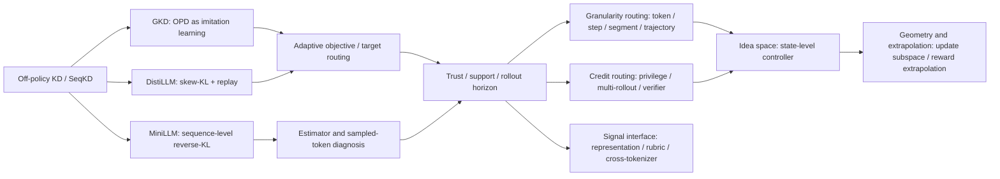

# OPD 方法谱系报告

> 目标：服务后续 idea 生成与 novelty risk 判断。本文不是逐篇摘要，而是把 71 张已验证 L1 cards 编成可读的研究地图。
>
> 证据基线：`scripts/autoresearch.py status` 于 2026-06-15 刷新后显示核心卡 71、候选论文 68、validation issues 0。本文使用已验证 L1 cards、`_meta/generated/research-map.md`、`_meta/generated/idea-context.md` 和必要 bounded briefs；没有新增完整 PDF 精读。

## 核心结论

事实：OPD 的初始问题是 exposure bias。student 自己 rollout 后，训练状态更接近推理时状态；teacher 在这些 student prefixes 上给 dense supervision。GKD、MiniLLM、DistiLLM 是这条线的三个起点，分别代表 framework、sequence-level reverse-KL、stabilized token-level objective。

解释：现在 OPD 的真正瓶颈不是“on-policy 是否有用”，而是 **student 访问到的 state 是否仍在 teacher 可监督、student 可学习、evaluation 可验证的区域内**。因此 2026 年大量工作集中在 trust、filter、granularity、credit、privilege 和 geometry，而不只是 KL 形式。

开放问题：一个能产生顶会级新意的 OPD 方法，需要同时回答四个问题：

1. 哪些 student states 应该进入训练？
2. teacher signal 在这些 states 上是否可信？
3. token / step / segment / trajectory 哪个粒度承载真正 credit？
4. 训练后的改变量到底落在能力相关的 state / parameter subspace 上，还是只是在匹配表面分布？

## 阅读路径

| 目的 | 读哪份 | 读完应得到什么 |
|---|---|---|
| 快速建立全局图 | [`01-lineage.md`](01-lineage.md) | OPD 从 GKD/MiniLLM/DistiLLM 到 2026 机制分析的分叉 |
| 理解方法设计 | [`02-mechanisms-and-decision-axes.md`](02-mechanisms-and-decision-axes.md) | rollout、loss、signal、filter、granularity 为什么是关键轴 |
| 查失败模式 | [`03-failure-modes-and-evidence.md`](03-failure-modes-and-evidence.md) | 每类 failure mode 的症状、代表方法、未解决问题、可信度 |
| 生成 idea | [`04-idea-hooks.md`](04-idea-hooks.md) | 非增量研究机会、最小实验、强 baseline、reviewer 攻击点 |
| 追证据 | [`05-evidence-and-limits.md`](05-evidence-and-limits.md) | 哪些结论来自 cards/generated context，哪些还需要 L2 deep note |

## 方法谱系一眼图

## 报告口径

L1 cards 已经覆盖单篇论文的核心方法、原理、创新点、决策点、解决的问题和谱系位置。本报告只做跨论文判断：方法族如何分叉、哪些 failure mode 互相遮蔽、哪些证据可信、哪些方向有 idea 空间。

强结论必须能追到 L1 card、bounded brief、generated research map 或报告 appendix。若后续为了某个 idea 新读原文，需要把新增证据写进 L2 note 或本报告 evidence 文件，避免新会话/compact 后重复读原文。
